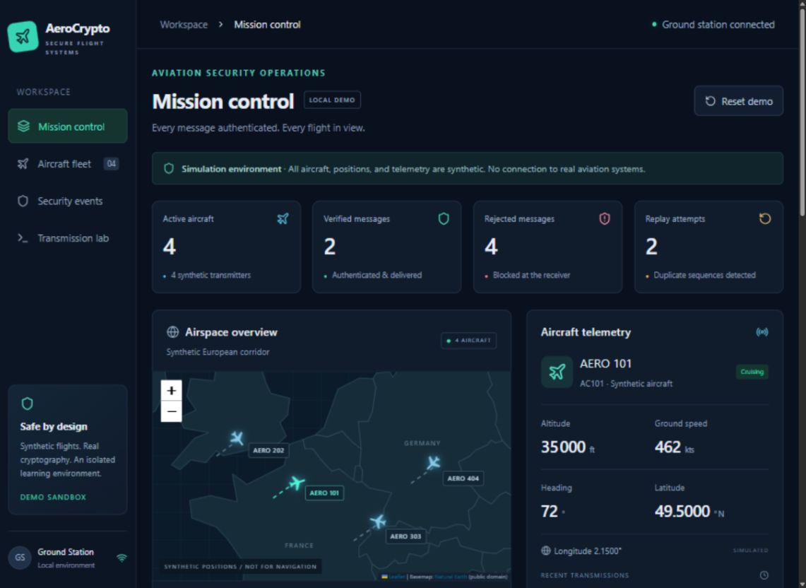
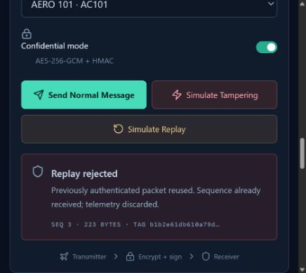
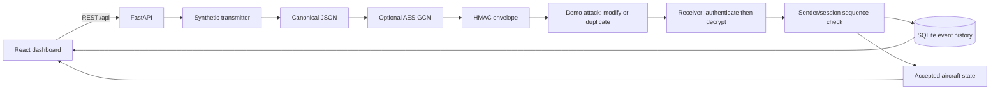

# AeroCrypto — Secure Aviation Telemetry Dashboard

A practical full-stack cybersecurity portfolio project: four synthetic aircraft transmit telemetry to a Python ground station. Inspect genuine backend authentication decisions, change a packet in transit, and replay a previously received message from a polished aviation dashboard.

**Synthetic data only. No ADS-B, radio equipment, real aircraft feeds, or aviation infrastructure.**

## Screenshots

Actual screenshots captured from the running web application. All aircraft and messages shown are simulated.

### Mission control dashboard

The dashboard brings together the synthetic flight map, aircraft telemetry, verified-message counters and rejected-message metrics.



### Replay protection in confidential mode

The transmission lab shows an authenticated packet being rejected because its sequence number has already been received. Confidential mode enables AES-256-GCM encryption in addition to the HMAC envelope.



## Technology stack

| Layer | Technology |
| --- | --- |
| Frontend | React, TypeScript, Vite, Tailwind CSS and custom CSS |
| Backend | Python and FastAPI |
| Authentication | HMAC-SHA256 with constant-time comparison |
| Encryption | AES-256-GCM using the Python cryptography library |
| Event storage | SQLite |
| Flight map | Leaflet with a bundled Natural Earth basemap |
| Charts | Recharts |
| Automated tests | pytest, Vitest and React Testing Library |

## Features

- React + TypeScript + Vite + Tailwind dashboard, Leaflet flight map and Recharts activity visualization.
- Deterministic starting aircraft with callsigns, coordinates, altitude, speed, heading and flight status.
- Canonical JSON and HMAC-SHA256 with constant-time tag comparison.
- Optional AES-256-GCM confidentiality, independent encryption and MAC keys, unique counter-based nonces.
- Receiver-side replay rejection scoped to sender and session.
- SQLite security history, metrics, aircraft message history and reset.
- Typed FastAPI endpoints with interactive documentation at `/docs`.

## Architecture



Both transmitter and receiver run inside one backend process. Their message boundary is a serialized cryptographic envelope; this is an educational channel simulator, not a distributed aircraft protocol. No private keys are returned to React.

## Quick start — Windows PowerShell

Requires Python 3.11+ and Node.js 20.19+ (or 22.12+). From the project directory:

```powershell
cd backend
python -m venv .venv
.\.venv\Scripts\python -m pip install -r requirements.txt
.\.venv\Scripts\python -m uvicorn app.main:app --host 127.0.0.1 --port 8000
```

In a second terminal, from the project directory:

```powershell
cd frontend
npm ci
npm run dev
```

Open http://127.0.0.1:5173. API documentation: http://127.0.0.1:8000/docs.

macOS/Linux: replace `.\.venv\Scripts\python` with `.venv/bin/python`; all other commands are the same. The Vite server proxies `/api` to port 8000. Environment variables are optional; see `.env.example`. The backend reads shell environment variables (it does not automatically load `.env`).

## Demo controls

| Control | What happens | Expected result |
| --- | --- | --- |
| Send Normal Message | Sends an intact, authenticated telemetry packet | Accepted |
| Simulate Tampering | Flips one payload byte after authentication | Invalid authentication |
| Simulate Replay | Resends the last accepted packet | Replay rejected |
| Confidential mode | Encrypts new telemetry packets with AES-GCM | The same security checks apply |

**Simulate Tampering is supposed to produce an invalid-authentication result every time.** It deliberately changes a protected message to demonstrate that the receiver detects and blocks the change.

## Demo walkthrough

1. Select any aircraft using its map marker or fleet tab.
2. Click **Send Normal Message**. The receiver authenticates the packet, advances its sequence watermark, moves the aircraft forward by ten synthetic seconds along its heading, applies any climb/descent change and records an accepted event.
3. Click **Simulate Tampering**. The transmitter seals a fresh packet; the attack flips one payload byte. The receiver rejects it before updating flight or replay state.
4. Click **Simulate Replay**. The backend resends the exact last accepted envelope. Its valid authentication passes, but the old sequence is rejected. If no message exists for that aircraft, a normal transmission is first generated and recorded automatically.
5. Enable **Confidential mode** and repeat. Telemetry is encrypted before the HMAC envelope is constructed. Replay uses the original packet's mode even if you change the toggle.
6. Review event explanations, activity, counters and aircraft history. **Reset demo** deletes event history, resets positions and sequences, and rotates all keys and the session.

Data refreshes every five seconds and immediately after actions. Flights advance only when you send an accepted packet; there is no external feed or background flight traffic. Chart values indicate each packet's outcome (0/1), not rates or cumulative counts. The feed shows the newest 12 matching events from the latest 100 loaded; `/api/events?limit=500` offers a larger window.

## API

| Method | Route | Purpose |
| --- | --- | --- |
| GET | `/api/health` | Liveness and synthetic-only flag |
| GET | `/api/aircraft` | Retrieve the current synthetic aircraft fleet and telemetry state |
| GET | `/api/state` | Fleet, session ID, newest 100 events and lifetime counters |
| POST | `/api/messages` | Transmit normal, tampered or replayed backend packet |
| GET | `/api/events?limit=100` | Newest events, bounded 1–500 |
| POST | `/api/reset` | Clear history and regenerate the demo |

Example request:

```json
{"aircraft_id":"AC101","action":"tamper","confidential":true}
```

Actions are `normal`, `tamper`, `replay`; aircraft IDs are `AC101`, `AC202`, `AC303`, `AC404`. Validation errors return 422. Security rejections return 200 with the receiver's explicit `outcome`: `accepted`, `invalid_authentication`, or `replay`.

## Security design and limits

Canonical serialization uses UTF-8 JSON, sorted keys, compact separators and disallows NaN/Infinity. The HMAC covers `mode || NUL || nonce || payload`; payload is canonical plaintext or AES-GCM ciphertext with its GCM tag. Sender, session, sequence and telemetry are inside this authenticated payload. HMAC verification uses Python [`hmac.compare_digest`](https://docs.python.org/3/library/hmac.html). This serialization is consistent inside this Python application; it is not a claim of a cross-language canonical JSON standard.

AES-GCM uses a new random 256-bit key per backend lifetime/reset. A 96-bit nonce combines a random 32-bit prefix and monotonically increasing 64-bit counter. A lock serializes sealing and receiving; the counter refuses exhaustion. Reset replaces the key before restarting the counter. This follows the cryptography library's [nonce uniqueness requirement](https://cryptography.io/en/stable/hazmat/primitives/aead/). AES-GCM already authenticates ciphertext; the additional independent HMAC keeps the demo's authentication step consistent across both modes.

Replay state is a high-water mark per `(sender, session)` and is consulted only after successful authentication. Lower or equal sequences are rejected, so delayed/out-of-order valid packets are also rejected. There is no sliding window, expiry, session negotiation, per-aircraft key isolation, remote identity provisioning or timestamp freshness check. The trusted backend creates sessions and keys. A compromised shared key could forge any sender. This is not production aviation security software.

Keys, replay watermarks, sequences and active flight state are **ephemeral**. Restart creates fresh keys/session; packets from old keys fail authentication. SQLite event history and its aggregate counters persist across restarts until reset, so historical counts can span sessions. Run exactly **one Uvicorn worker**; multiple workers would have inconsistent keys/state. Local endpoints intentionally have no login and reset has no confirmation; bind to loopback and do not expose the demo as a public service. SQLite history grows until reset. A production service would need authentication, TLS, rate limits, retention, durable replay state and managed key lifecycle.

The UI map uses Leaflet with a bundled, simplified [Natural Earth 1:110m country basemap](https://github.com/nvkelso/natural-earth-vector/blob/master/geojson/ne_110m_admin_0_countries.geojson). Natural Earth data is [public domain](https://www.naturalearthdata.com/about/terms-of-use/); country names and regional geometry are included in `frontend/src/data/europe.json`. It makes no runtime map or aviation requests and requires no map API keys. Boundaries are for illustrative context only; the map is not for navigation.

## Tests and production build

```powershell
cd backend
.\.venv\Scripts\python -m pytest -q
cd ../frontend
npm test
npm run build
```

Local verification completed with **13 backend tests and 5 frontend tests passing**, plus a successful production build. See [VERIFICATION.md](VERIFICATION.md) for the checked flows and remaining limits.

Backend tests cover both modes, valid authentication, changed payload and envelope fields, replay, session/sender isolation, canonical ordering, nonce uniqueness/exhaustion, API validation, reset and persistent history. Lightweight frontend tests cover API requests, connection failures, outcome labels and submitting confidential attack settings from the dashboard. The optional workflow in `.github/workflows/ci.yml` is configured to run both suites and the frontend build when pushed to GitHub. `npm run build` produces `frontend/dist`; a production reverse proxy must route `/api` to FastAPI.

## Optional Docker

```sh
docker compose up --build
```

Open http://localhost:8080. Nginx serves the frontend and proxies `/api`; SQLite lives in the `telemetry` volume. `docker compose down -v` deletes that volume. Docker is optional; see verification notes for whether it was exercised.

## Repository layout

```text
backend/app/        API models, transmitter, receiver, SQLite service
backend/tests/      Security and API tests
frontend/src/       React dashboard, API types, styles and tests
.github/workflows/  CI checks
compose.yaml        Optional local containers
```

## License

This project is licensed under the [MIT License](LICENSE). Third-party basemap attribution is documented in [THIRD_PARTY_NOTICES.md](THIRD_PARTY_NOTICES.md).

AeroCrypto is a practical cybersecurity portfolio demonstration using synthetic telemetry. It is not intended for real aircraft operations.
